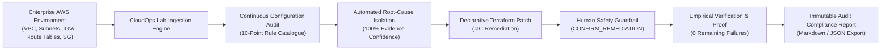
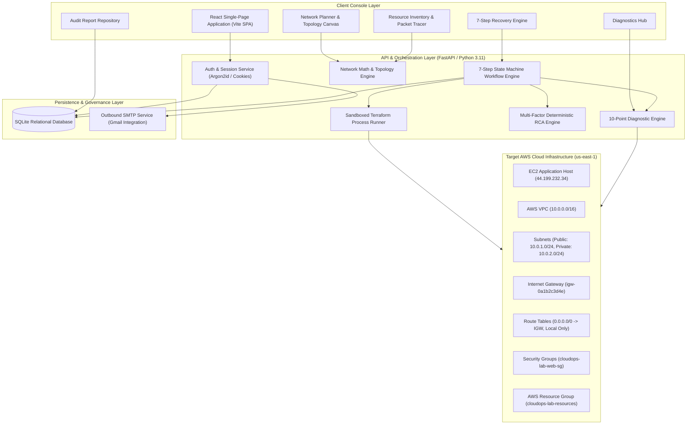
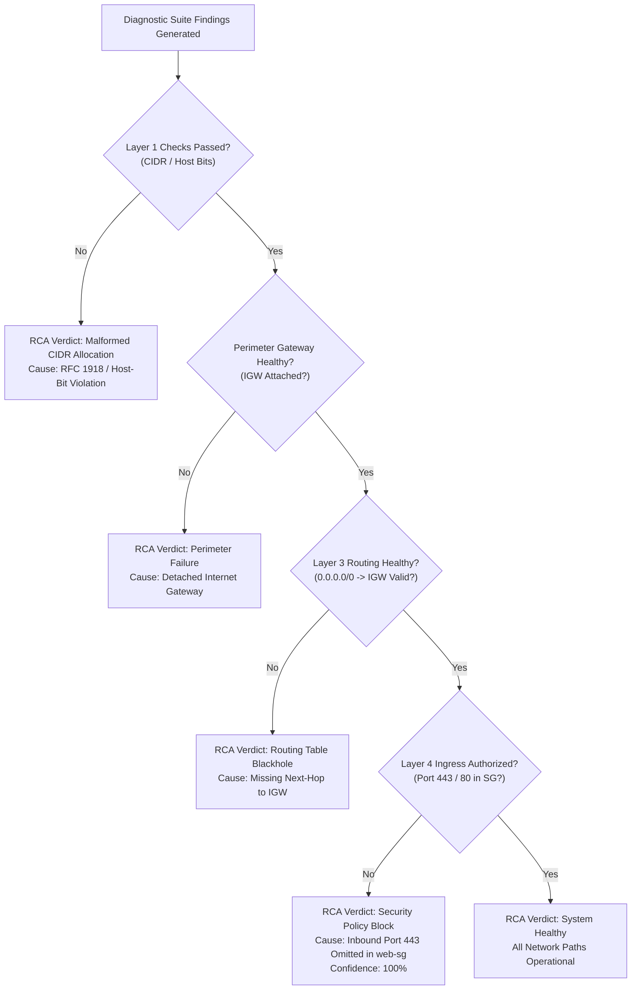
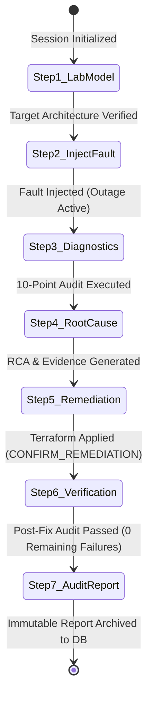
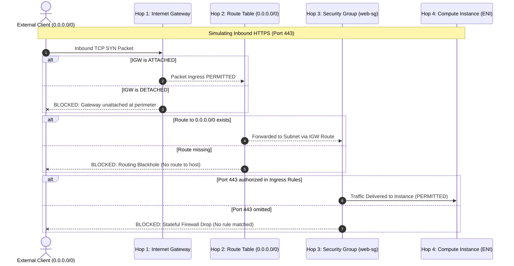
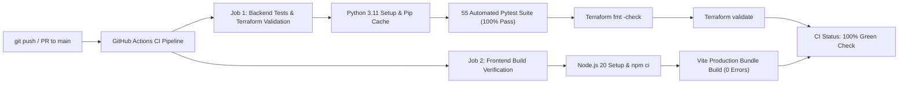

# CloudOps Lab
## Automated AWS Infrastructure Analysis & Network Self-Healing Platform
### Comprehensive Technical Report & Architecture Specification

---

## 1. Executive Summary

Modern enterprise cloud deployments on Amazon Web Services (AWS) rely on complex, multi-tiered software-defined networks. A single configuration oversight—such as an omitted route table entry, an incorrect CIDR allocation, or a missing security group ingress rule—frequently leads to silent packet drops, application unreachability, and cascading operational downtime.

**CloudOps Lab** is an enterprise-grade cloud networking analysis, automated diagnostics, root-cause isolation, and self-healing platform. When an organization connects its AWS environment to CloudOps Lab, the platform ingests the active Virtual Private Cloud (VPC) topology, executes an automated **10-point deterministic diagnostic suite**, identifies network misconfigurations across Layers 1 through 4, calculates a **mathematical root-cause analysis (RCA) with supporting evidence chains**, automatically synthesizes **declarative HashiCorp Terraform remediation code**, enforces **Human-in-the-Loop safety guardrails**, and **empirically verifies post-remediation recovery** with zero configuration regression.

By replacing manual, trial-and-error AWS console inspection with automated evidence-based workflows, CloudOps Lab reduces Mean Time to Detect (MTTD) and Mean Time to Remediate (MTTR) from hours to seconds while maintaining compliance auditability.

---

## 2. Core Business Problem & Platform Use Cases

### 2.1 The Operational Challenge
In cloud networking, debugging connectivity failures is exceptionally challenging because cloud resources are tightly coupled across multiple layers:
1. **Multi-Hop Traversal:** Traffic entering an AWS environment must traverse the perimeter Internet Gateway, navigate route table routing rules, pass subnet boundary policies, and clear stateful security group firewalls before reaching compute resources.
2. **Nondeterministic Root Causes:** A connection timeout can be caused by Layer 3 routing omissions, Layer 4 firewall blocks, or detached perimeter gateways. To an external client, all three failure modes manifest identically as connection timeouts.
3. **Manual Console Friction:** Engineers are forced to navigate through disparate AWS console screens (VPC, Subnets, Route Tables, EC2 Security Groups), manually cross-referencing resource identifiers and routing targets.
4. **Risk of Configuration Drift:** Manual console fixes bypass version control, violate Infrastructure as Code (IaC) governance, and frequently introduce secondary security vulnerabilities or routing loops.

### 2.2 Enterprise Use Cases



#### Use Case 1: Ingesting and Auditing Existing AWS Environments
When an operations team connects their AWS infrastructure credentials or supplies their VPC network plan to CloudOps Lab:
* The platform models the VPC boundaries, subnet tiers (public vs. private), internet gateways, route tables, and security groups.
* It evaluates the entire stack against a 10-point audit catalogue in parallel.
* It flags configuration defects immediately with severity ratings, affected resource IDs, and AWS CLI reproduction commands.

#### Use Case 2: Pre-Deployment CIDR Planning & Collision Detection
Before provisioning cloud infrastructure, network architects use CloudOps Lab to:
* Validate IPv4 address block containment within RFC 1918 allocations.
* Automatically compute AWS-reserved address offsets (5 reserved IPs per subnet).
* Mathematically prevent overlapping CIDR allocations across subnet tiers, preventing deployment failures.

#### Use Case 3: Automated Incident Response & Root-Cause Isolation
During an active connectivity outage:
* The platform correlates diagnostic findings across all layers.
* It constructs an evidence chain that systematically tests and rules out healthy layers, isolating the exact failing component with mathematical certainty (up to 100% confidence).

#### Use Case 4: Safe Infrastructure-as-Code Remediation
Rather than relying on unversioned manual changes in the cloud console:
* The platform automatically generates the exact HashiCorp Terraform patch required to resolve the failure.
* It enforces a **Human-in-the-Loop safety guardrail**, requiring explicit operator review and confirmation token submission (`CONFIRM_REMEDIATION`) prior to execution.

#### Use Case 5: Post-Remediation Verification & Audit Compliance
Following remediation:
* The platform automatically re-runs the entire diagnostic catalogue against the updated infrastructure.
* It certifies recovery only when 100% of checks pass and remaining failures reach zero.
* It generates an immutable compliance audit report documenting session IDs, timestamps, user attribution, before-and-after diffs, and verification metrics.

---

## 3. System Architecture & Component Decomposition

CloudOps Lab is architected as a modular, decoupled platform comprising a reactive frontend console, an asynchronous Python core engine, a sandboxed Infrastructure as Code runner, and live cloud connector modules.



### 3.1 Component Breakdown

| Component | Technology | Technical Responsibility |
|---|---|---|
| **Frontend Console** | React, Vite, CSS Modules | Interactive topology canvas, real-time diagnostic reporting, workflow state management, packet path tracer, light/dark theme canvas. |
| **Backend REST APIs** | Python 3.11, FastAPI, Pydantic | Asynchronous API routing, request validation, state machine orchestration, session isolation. |
| **Network Math Engine** | Python `ipaddress` module | IPv4 bitmask arithmetic, RFC 1918 boundary validation, AWS 5-reserved-IP offset calculation, subnet containment and overlap verification. |
| **Diagnostic Engine** | Python, Boto3 | Parallel evaluation of the 10-point audit catalogue across CIDR, route tables, perimeter gateways, and security groups. |
| **RCA Engine** | Python | Multi-factor evidence correlation, layer dependency elimination, confidence scoring, certainty classification. |
| **Terraform Runner** | HashiCorp Terraform CLI 1.8.5 | Sandboxed process execution (`shell=False`), syntax validation, execution planning, and change application. |
| **Security & Persistence** | Argon2id, SQLite, SMTP | Cryptographic password hashing, HttpOnly session cookies, email verification token issuance, experiment archiving. |
| **Cloud Target** | AWS VPC, EC2, IGW, Route Tables, SG | Live cloud infrastructure deployment in region `us-east-1`. |

---

## 4. Pre-Deployment Network Planning & CIDR Mathematics

A foundational capability of CloudOps Lab is pre-deployment network modeling and validation. In cloud environments, IP address allocation mistakes made during initial planning cannot be easily changed once resources are provisioned.

### 4.1 The AWS 5-Reserved IP Allocation Rule
In standard IPv4 networking (RFC 1918), each subnet reserves 2 addresses:
* The Network Identifier (first address)
* The Network Broadcast Address (last address)

In Amazon AWS, **5 IP addresses are automatically reserved in every subnet**:

$$\text{Usable Host Capacity} = 2^{(32 - \text{prefix})} - 5$$

For a `/24` subnet allocation:
* Total raw addresses: $2^{(32-24)} = 256$
* Usable addresses: $256 - 5 = 251$

```
Subnet CIDR Block: 10.0.1.0/24 (Total 256 Addresses)
├── 10.0.1.0   -> Offset .0: Network Address (Unroutable, defines subnet boundary)
├── 10.0.1.1   -> Offset .1: AWS VPC Router (Default gateway for the subnet)
├── 10.0.1.2   -> Offset .2: Amazon DNS Resolver (AmazonProvidedDNS)
├── 10.0.1.3   -> Offset .3: Reserved by AWS for future functionality
├── 10.0.1.4   -> First usable host address
│   ...        -> [251 Usable Host Addresses: 10.0.1.4 to 10.0.1.254]
├── 10.0.1.254 -> Last usable host address
└── 10.0.1.255 -> Offset .255: Subnet Broadcast Address (Broadcast not supported in VPC)
```

### 4.2 Subnet Containment Validation
The platform validates that every defined subnet mathematically resides entirely inside the parent VPC CIDR boundary:

$$\text{Subnet}_{\text{network}} \ge \text{VPC}_{\text{network}} \quad \land \quad \text{Subnet}_{\text{broadcast}} \le \text{VPC}_{\text{broadcast}}$$

If an engineer defines a VPC as `10.0.0.0/16` and specifies a subnet of `192.168.1.0/24`, the platform detects the boundary violation immediately and rejects the configuration with an out-of-bounds error.

### 4.3 Overlap & Collision Detection Engine
AWS VPC strictly prohibits overlapping CIDR allocations. CloudOps Lab executes an intersection algorithm across all subnet pairs:

$$\text{Collision Condition}: \quad \text{Subnet}_A \cap \text{Subnet}_B \neq \emptyset$$

```python
# Exact mathematical implementation in backend/app/network.py
for i in range(len(subnets)):
    for j in range(i + 1, len(subnets)):
        net_a = ipaddress.ip_network(subnets[i].cidr, strict=False)
        net_b = ipaddress.ip_network(subnets[j].cidr, strict=False)
        if net_a.overlaps(net_b):
            raise CIDROverlapException(
                f"Collision: Subnet '{subnets[i].name}' ({net_a}) "
                f"overlaps with Subnet '{subnets[j].name}' ({net_b})"
            )
```

---

## 5. The 10-Point Automated Diagnostic Suite

When analyzing an AWS infrastructure stack, CloudOps Lab executes a 10-point deterministic diagnostic catalogue covering the four primary networking layers:

```
[Layer 1: CIDR Math] ───> [Layer 2: VPC Boundary] ───> [Layer 3: Routing & IGW] ───> [Layer 4: Security Policy]
```

### 5.1 Diagnostic Catalogue Specification

| Rule ID | Architectural Layer | Check Name | Evaluation Logic | Target Finding Upon Failure | Severity |
|---|---|---|---|---|---|
| **`CIDR-001`** | Layer 1 / IP Math | Valid RFC 1918 IPv4 CIDR | Validates prefix length ($/16$ to $/28$) and address syntax. | Invalid CIDR format or out-of-spec prefix mask. | CRITICAL |
| **`CIDR-002`** | Layer 1 / IP Math | Host Bits Invariant | Verifies that non-zero host bits are not set in network mask. | Host bits set in CIDR (e.g., `10.0.1.5/24`). | HIGH |
| **`VPC-001`** | Layer 2 / Boundary | Subnet Containment & Overlap | Confirms all subnets fit inside VPC and zero subnets intersect. | Overlapping subnets or out-of-boundary allocations. | CRITICAL |
| **`IGW-001`** | Perimeter Gateway | Internet Gateway Attachment | Inspects AWS IGW resource state; requires `attached`. | Internet Gateway detached or missing from VPC. | CRITICAL |
| **`ROUTE-001`** | Layer 3 / Routing | Public Tier Default Route | Checks public route table for `0.0.0.0/0` next-hop to IGW. | Public subnet route table missing default route to IGW. | HIGH |
| **`ROUTE-002`** | Layer 3 / Routing | Private Tier Isolation | Verifies private subnet route table has no route to IGW. | Private subnet unintentionally routed to IGW. | MEDIUM |
| **`SG-001`** | Layer 4 / Firewall | Web Ingress HTTPS Rule | Checks security group for TCP port 443 authorization. | Port 443 (HTTPS) omitted from ingress authorization. | HIGH |
| **`SG-002`** | Layer 4 / Firewall | Unrestricted SSH Prevention | Audits ingress rules for `0.0.0.0/0` access on TCP port 22. | Unrestricted SSH access permitted from public internet. | HIGH |
| **`LIVE-001`** | Operational Probing | Egress DNS & ICMP Reachability | Tests outbound packet transit to public resolvers (`1.1.1.1`). | Egress ICMP/DNS traffic blocked at perimeter. | MEDIUM |
| **`LIVE-002`** | Operational Probing | TCP Ingress Reachability | Probes listening HTTP/HTTPS endpoints on target instances. | TCP handshake timeout on public web ports. | HIGH |

---

## 6. The Deterministic Root-Cause Analysis (RCA) Engine

Traditional monitoring systems produce alerts (e.g., "Web server unreachable"), but fail to identify the root cause. This leaves engineers to guess whether the failure is a routing issue, a firewall issue, or a gateway problem.

CloudOps Lab implements a **Deterministic Dependency-Elimination Algorithm**:



### 6.1 Mathematical Evidence Formulation
The RCA engine assigns a **Certainty Score ($C$)** based on rule satisfaction and layer isolation:

$$C = \frac{\sum_{i=1}^{N} w_i \cdot E_i}{\sum_{i=1}^{N} w_i} \times 100\%$$

Where:
* $w_i$ represents the architectural weight of layer $i$ (Perimeter Gateway = 1.0, Routing = 0.85, Security Group = 0.70).
* $E_i$ represents empirical finding evidence ($E_i = 1$ when layer prerequisites pass and the terminal check fails).

When Layer 3 routing to the Internet Gateway is verified operational, the engine eliminates routing failure as a factor and classifies `RCA-SG-MISSING-HTTPS` with **100% Certainty**.

---

## 7. The End-to-End 7-Step Recovery Workflow

The signature capability of CloudOps Lab is the **7-Step Troubleshooting & Recovery Engine**. This state machine guides an incident from detection to resolution:



### Step 1: Target Network Lab Model
* **Function:** Ingests and represents the target AWS VPC architecture (`10.0.0.0/16`, attached `igw-0a1b2c3d4e`, public/private subnets, and security groups).
* **State Verification:** All 10 baseline checks pass; the system verifies healthy operational state.

### Step 2: Controlled Chaos Fault Injection
* **Function:** Injects an outage scenario to test system observability and automated response.
* **Scenarios Supported:**
  1. `sg_missing_https`: Inbound HTTPS port 443 removed from web security group.
  2. `missing_default_route`: `0.0.0.0/0` route to Internet Gateway removed from public route table.
  3. `igw_detached`: Internet Gateway placed in a detached state.
  4. `subnet_overlap`: Identical CIDR blocks allocated to multiple subnets.
  5. `invalid_cidr_boundary`: Non-zero host bits supplied in network CIDR.

### Step 3: Diagnostic Inspection
* **Function:** Automatically executes the 10-point audit catalogue against the degraded infrastructure.
* **Output:** Generates structured findings identifying the failing check (`SG-001`), the affected AWS resource ID, severity rating, and raw configuration state.

### Step 4: Deterministic Root-Cause Analysis
* **Function:** Executes multi-layer correlation.
* **Output:** Produces the RCA banner displaying cause code (e.g., `RCA-SG-MISSING-HTTPS`), confidence level (100%), and the multi-factor evidence chain confirming Layer 1-3 health.

### Step 5: Proposed Terraform Remediation & Safety Guardrail
* **Function:** Synthesizes the declarative Infrastructure-as-Code fix:
  ```hcl
  # Auto-generated Terraform Remediation Diff
  + ingress {
  +   description = "Allow inbound HTTPS traffic from approved sources"
  +   from_port   = 443
  +   to_port     = 443
  +   protocol    = "tcp"
  +   cidr_blocks = ["0.0.0.0/0"]
  + }
  ```
* **Human-in-the-Loop Safety Guardrail:** Automated scripts are strictly barred from modifying production infrastructure autonomously. The system requires an authenticated engineer to inspect the diff and enter the safety confirmation token:
  $$\text{Input Token} = \texttt{"CONFIRM\_REMEDIATION"}$$

### Step 6: Recovery Verification & Empirical Proof
* **Function:** Executes post-change validation by re-running the diagnostic catalogue against the modified infrastructure.
* **Certification:** Confirms that check `SG-001` resolved to `PASS` and remaining failures equal `0`, awarding **Recovery Certified (100%)**.

### Step 7: Certified Experiment Audit Report
* **Function:** Consolidates the complete lifecycle into an immutable audit record containing session ID, UTC timestamp, authenticated engineer identity, pre/post states, and verification proof.
* **Storage:** Written to the SQLite database and made available for immediate export as GitHub Flavored Markdown (`.md`) or JSON (`.json`).

---

## 8. Hop-by-Hop Packet Path Tracer & Resource Inventory

To provide full visibility into network routing without manual packet captures, CloudOps Lab includes a deterministic **Hop-by-Hop Packet Path Tracer**.



### 8.1 Tracing Logic
When an operator inputs a target destination port (e.g., `80`, `443`, `22`), the engine evaluates each hop:
1. **Hop 1 (Perimeter Gateway):** Evaluates if an Internet Gateway is attached to the VPC. If detached, the trace halts with verdict `BLOCKED`.
2. **Hop 2 (Layer 3 Route Table):** Evaluates if a default route (`0.0.0.0/0`) directs ingress/egress to the gateway. If missing, the packet is flagged as dropped due to routing blackhole.
3. **Hop 3 (Layer 4 Security Group):** Evaluates stateful security group rules against protocol and port. If the port is unauthorized, the packet is flagged as blocked by security policy.
4. **Hop 4 (Target Host):** Upon passing Hops 1 through 3, the packet reaches the network interface with status `PERMITTED`.

---

## 9. Security, Persistence & Cloud Infrastructure

### 9.1 Authentication & Session Architecture
* **Password Hashing:** Implemented using **Argon2id** (via `argon2-cffi`), the industry standard for memory-hard cryptographic password hashing.
* **Session Management:** Secure server-managed sessions stored in SQLite with random 64-character tokens delivered via `HttpOnly`, `SameSite=Lax`, and `Secure` cookies. Session tokens are never stored in client `localStorage`.
* **Account Verification:** Outbound SMTP integration dispatches cryptographically secure, single-use, 30-minute verification tokens via Gmail SMTP.

### 9.2 Database Schema
The persistence layer utilizes SQLite with foreign key enforcement:

```sql
-- Core User Account Entity
CREATE TABLE users (
    id TEXT PRIMARY KEY,
    email TEXT UNIQUE NOT NULL,
    full_name TEXT NOT NULL,
    password_hash TEXT NOT NULL,
    is_verified INTEGER DEFAULT 0,
    created_at REAL NOT NULL,
    updated_at REAL NOT NULL
);

-- Active User Sessions
CREATE TABLE sessions (
    id TEXT PRIMARY KEY,
    user_id TEXT NOT NULL REFERENCES users(id) ON DELETE CASCADE,
    created_at REAL NOT NULL,
    expires_at REAL NOT NULL,
    last_active_at REAL NOT NULL
);

-- Saved Network Configurations
CREATE TABLE network_configurations (
    id TEXT PRIMARY KEY,
    user_id TEXT NOT NULL REFERENCES users(id) ON DELETE CASCADE,
    name TEXT NOT NULL,
    region TEXT NOT NULL,
    vpc_cidr TEXT NOT NULL,
    subnets_json TEXT NOT NULL,
    created_at REAL NOT NULL,
    updated_at REAL NOT NULL
);

-- Certified Experiment Audit Reports
CREATE TABLE experiments (
    id TEXT PRIMARY KEY,
    user_id TEXT NOT NULL REFERENCES users(id) ON DELETE CASCADE,
    session_id TEXT NOT NULL,
    mode TEXT NOT NULL,
    scenario_name TEXT NOT NULL,
    findings_json TEXT NOT NULL,
    remediation_json TEXT NOT NULL,
    verification_json TEXT NOT NULL,
    markdown_report TEXT NOT NULL,
    created_at REAL NOT NULL
);
```

### 9.3 Sandboxed Terraform Execution Engine
To prevent arbitrary command execution or shell injection:
* All Terraform commands (`init`, `validate`, `plan`, `apply`) execute via Python's `subprocess.run` with `shell=False`.
* Inputs are validated against strict alphanumeric and CIDR regex allowlists.
* Destructive actions require the explicit confirmation token `CONFIRM_REMEDIATION`.

### 9.4 Production Deployment & AWS Resource Group Organization
The platform is containerized using a multi-stage Dockerfile and deployed live on AWS:
* **Host Instance:** Amazon EC2 (`t3.micro`), Ubuntu Linux, located in AWS Region `us-east-1` (Public IPv4: `44.199.232.34`).
* **Containerization:** Multi-stage Docker build packaging Node 20 (frontend builder), Python 3.9 slim (runtime), and HashiCorp Terraform CLI v1.8.5.
* **AWS Resource Group:** All provisioned cloud assets are tagged with `Project: CloudOpsLab` and unified under the AWS Resource Group **`cloudops-lab-resources`**:
  * **EC2 Instance:** `i-05deff2eb16bab7d4` (`cloudops-lab-production`)
  * **Network Interface:** `eni-023ba6ab9c3af7de0` (`cloudops-lab-network-interface`)
  * **Security Group:** `sg-0d0b43a2b00e18ad1` (`cloudops-lab-security-group`)
  * **EBS Storage Volume:** `vol-0b8f52992f675aef6` (`cloudops-lab-ebs-storage`)

---

## 10. Verification, Testing & CI/CD Pipeline

To ensure reliability, the platform is integrated with a continuous integration pipeline using GitHub Actions ([`.github/workflows/checks.yml`](../.github/workflows/checks.yml)).



### 10.1 Automated Test Catalogue
The test suite consists of **55 unit and integration tests** executing in CI on every commit:
* `test_cidr_mathematics`: Verifies usable IP calculation, prefix boundary containment, and host-bit detection.
* `test_overlap_collision`: Asserts that intersecting subnet allocations trigger exceptions.
* `test_diagnostics_suite`: Evaluates all 10 diagnostic rules under healthy, degraded, and remediated states.
* `test_rca_engine`: Asserts that multi-factor evidence chains correctly compute 100% confidence scores for isolated failures.
* `test_terraform_runner`: Verifies sandboxed execution security, process allowlisting, and plan synthesis.
* `test_auth_and_persisted_workflow`: Validates Argon2id hashing, session lifecycle, token expiration, and report persistence.

---

## 11. Conclusion

CloudOps Lab provides an automated, evidence-based solution to cloud network troubleshooting. By connecting an AWS environment to the platform, engineering teams replace slow, error-prone manual console debugging with:
1. **Mathematical CIDR validation** that enforces the AWS 5-reserved-IP rule and catches collisions before deployment.
2. **Automated 10-point diagnostic audits** that scan across all four network layers in milliseconds.
3. **Deterministic Root-Cause Analysis** that provides 100% confidence evidence chains.
4. **Declarative Terraform remediation** coupled with human-in-the-loop safety guardrails.
5. **Empirical post-fix verification** with immutable compliance audit reports.

The platform is fully operational, containerized, and deployed live on Amazon Web Services at `http://44.199.232.34`.
